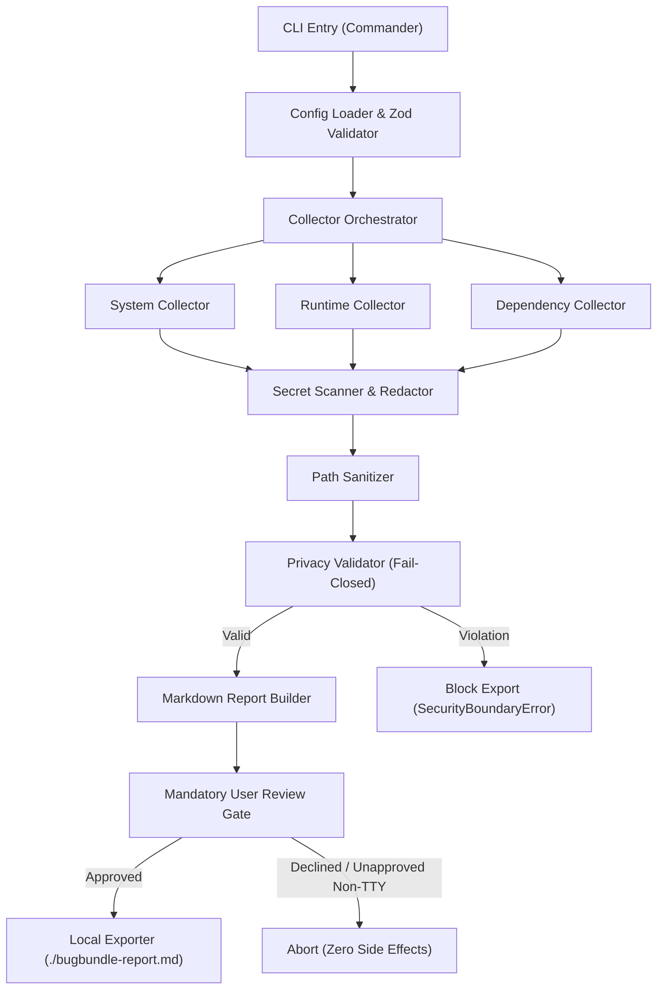

# Architecture Specification — `bugbundle`

This document defines the software architecture, data flow, module responsibilities, command contracts, error handling, security boundaries, and extension points for `bugbundle`.

> **Design Philosophy:** Keep Phase 1 simple, modular, deterministic, and strictly local-first. Avoid premature abstraction while preserving clean interfaces for future collectors and formatters.

---

## 1. Architectural Overview & Data Flow

`bugbundle` executes as a unidirectional local pipeline. Every diagnostic run flows through discrete, testable stages:



### Execution Lifecycle

1. **CLI Parse:** Commander parses arguments/flags (`collect`, `inspect`, `init`) and resolves target command & working directory.
2. **Config Validation:** Configuration (CLI flags and optional `bugbundle.config.json` per [DEC-007](./DECISIONS.md#dec-007)) is validated via Zod schemas before any collector runs.
3. **Collector Execution:** The orchestrator runs enabled collectors in isolation (`PathSecurityGuard` excludes `.env`, SSH keys, credentials, shell histories, browser profiles, `node_modules`, and non-allowlisted files before reading). Missing optional tools or individual collector failures are captured as structured warnings/errors without crashing healthy collectors ([DEC-013](./DECISIONS.md#dec-013)).
4. **Security Pipeline (`SecurityPipeline`):** Approved collected data passes sequentially through `SecretScanner`, `RedactionEngine`, `PathSanitizer`, and fail-closed `PrivacyValidator`. Any residual secret, private-key material, or unsanitized home path blocks export via `SecurityBoundaryError`.
5. **Report Rendering:** The Markdown builder renders the sanitized `DiagnosticBundle` into deterministic Markdown.
6. **Mandatory Review Gate (`collect`):** The user inspects a preview or summary of the generated report in the terminal and must explicitly approve export. In non-interactive mode, export is refused unless an explicitly documented approval mechanism is supplied ([DEC-006](./DECISIONS.md#dec-006)).
7. **Export (`collect`):** Only upon approval is the report written to `./bugbundle-report.md` (or `--output <path>`), warning clearly if the file already exists and **never silently overwriting** ([DEC-005](./DECISIONS.md#dec-005)). (`bugbundle inspect` stops after step 5/display and never writes a report file.)

---

## 2. Module Responsibilities

Planned logical modules under `src/` (exact module format/extensions pending [DEC-002](./DECISIONS.md#dec-002)):

| Module       | Responsibility                                                                                                                                                                                                                                  | Must NOT Do                                                                                                                          |
| :----------- | :---------------------------------------------------------------------------------------------------------------------------------------------------------------------------------------------------------------------------------------------- | :----------------------------------------------------------------------------------------------------------------------------------- |
| `cli`        | Commander setup, flags, help text, Chalk terminal presentation, mapping errors to exit codes.                                                                                                                                                   | Directly inspect OS/files or bypass the review gate.                                                                                 |
| `config`     | `schema.ts`, `loader.ts`, `init.ts`: discover/parse `bugbundle.config.json`, validate strictly with Zod (rejecting unknown fields/bypass attempts), scaffold starter configs, and produce `ValidatedConfig`.                                    | Read `.env` files, execute config values, silently overwrite existing configs, or allow security bypasses.                           |
| `core`       | `DiagnosticOrchestrator` (and future `CollectorRegistry`): manage enabled collectors, enforce execution isolation, aggregate `CollectorResult`s into `DiagnosticBundle`.                                                                        | Implement collector-specific business logic or perform network I/O.                                                                  |
| `collectors` | Self-contained Phase 1 collectors (`system`, `runtimes`, `dependencies`) implementing the `Collector` interface.                                                                                                                                | Read `.env`/credentials, recursively scan `node_modules`, read arbitrary unapproved paths, or write files.                           |
| `security`   | Collection-boundary `PathSecurityGuard` (allowlist + `.env`/SSH/credential/shell-history/browser-profile/`node_modules` denylist) and `SecurityPipeline` (`SecretScanner`, `RedactionEngine`, `PathSanitizer`, fail-closed `PrivacyValidator`). | Allow collector bypasses, expose original secrets in metadata/errors, or swallow validation failures.                                |
| `report`     | `markdown-builder.ts` & `types.ts`: pure transformation converting `SecurityPipeline`-validated `DiagnosticBundle` into escaped GitHub-Flavored Markdown (`buildMarkdownReport`, `createReportInputFromPipeline`).                              | Bypass `SecurityPipeline`, perform filesystem/env inspection, or allow Markdown/HTML injection.                                      |
| `review`     | `review-gate.ts` & `types.ts`: display sanitized Markdown preview, require default-No `(y/N)` confirmation via `node:readline/promises`, handle `Ctrl+C`/EOF safely, and refuse non-interactive export without `--yes`.                         | Auto-approve silently, bypass `SecurityPipeline`, or leak raw collector output.                                                      |
| `export`     | `report-exporter.ts` & `types.ts`: validate destination relative to `cwd`, block traversal/symlinks/restricted paths, refuse existing files (`lstat` + `wx` exclusive write), and return structured result.                                     | Upload remotely, write without `ReviewApproval` + `securityValidated`, create unexpected dirs, or silently overwrite existing files. |
| `errors`     | `bugbundle-error.ts` & `exit-codes.ts`: typed `BugbundleError` hierarchy, safe `formatCliError`, and single centralized `EXIT_CODES` / `resolveExitCode` mapping ([DEC-010](./DECISIONS.md#dec-010)).                                           | Include raw secrets/unredacted paths in error messages or scatter numeric exit codes.                                                |
| `types`      | Shared strict TypeScript types and Zod-inferred schemas (`DiagnosticContext`, `CollectorResult`, `DiagnosticBundle`).                                                                                                                           | Contain runtime side effects.                                                                                                        |

---

## 3. Core Contracts & Interfaces

### 3.1 Collector Contract

Each collector is an independent module implementing a common contract:

```ts
export type CollectorStatus = 'ok' | 'partial' | 'skipped' | 'error';

export interface CollectorMetadata {
  readonly id: string; // e.g. 'system', 'runtime', 'dependencies'
  readonly name: string; // Human-readable name
  readonly description: string; // Shown in CLI help / review summary
  readonly sensitivity: 'low' | 'moderate'; // Guides review highlighting
}

export interface DiagnosticContext {
  readonly cwd: string;
  readonly config: ValidatedConfig;
  readonly securityGuard: SecurityGuard;
}

export interface CollectorResult<TData = unknown> {
  readonly id: string;
  readonly status: CollectorStatus;
  readonly data?: TData;
  readonly warnings: readonly string[];
  readonly error?: SafeErrorSummary;
  readonly durationMs: number;
}

export interface Collector<TData = unknown> {
  readonly meta: CollectorMetadata;
  collect(ctx: DiagnosticContext): Promise<CollectorResult<TData>>;
}
```

**Invariants:**

- Collectors receive `securityGuard` for any filesystem access; raw `fs` reads of arbitrary user paths are prohibited.
- Collectors return structured `CollectorResult` objects rather than throwing unhandled exceptions for recoverable environmental issues (e.g., missing `package.json`).
- Unhandled exceptions inside a collector are caught by the `Orchestrator`, converted into `status: 'error'` with a sanitized summary, and isolated from other collectors.

### 3.2 CLI Command Contracts

Phase 1 defines three explicit subcommands (`bugbundle collect`, `bugbundle inspect`, `bugbundle init`) finalized in [DEC-004](./DECISIONS.md#dec-004). Exact exit codes remain open under [DEC-010](./DECISIONS.md#dec-010).

#### `bugbundle collect`

- **Purpose:** Run enabled collectors, sanitize output, render Markdown, present preview for user review, require explicit confirmation, and export `./bugbundle-report.md` (or `--output <path>`).
- **Inputs (Options Contract):**
  - Target directory (defaults to `process.cwd()`), validated to exist and be a directory.
  - `--output <path>`: Relative output path resolved against `cwd` (defaults to `report.filename` / `./bugbundle-report.md`; [DEC-005](./DECISIONS.md#dec-005)), validated via `validateExportDestination` and `exportReport`.
  - `--include <collectors>` / `--exclude <collectors>`: Comma-separated collector IDs (`system`, `runtimes`, `dependencies`) applied as strict narrowing filters on top of `bugbundle.config.json` ([DEC-014](./DECISIONS.md#dec-014)).
  - Config path (defaults to `./bugbundle.config.json` if present; [DEC-007](./DECISIONS.md#dec-007)).
  - `--yes`: Explicitly approves saving the sanitized report in non-interactive mode ([DEC-006](./DECISIONS.md#dec-006)).
- **Preconditions:**
  - All CLI options and loaded `bugbundle.config.json` pass Zod schema validation before collection begins.
- **Postconditions:**
  - Zero files are written if the user declines at the review gate, or if running non-interactively without an explicitly documented approval mechanism.
  - If the target output file already exists, emits a clear warning and **never silently overwrites**.
  - Zero `.env` or credential files are ever opened or read; `node_modules` is never recursively scanned.
  - Zero network calls are made.
  - Exit code reflects outcome (`0` on approved export, non-zero on validation/fatal error, refused non-interactive export, or user abort — exact codes pending [DEC-010](./DECISIONS.md#dec-010)).

#### `bugbundle inspect` _(Implemented — Milestone 4.3)_

- **Purpose:** Run enabled collectors through `executeDiagnosticPipeline`, pass data through `SecurityPipeline`, render the sanitized Markdown report via `buildMarkdownReport`, and print it to the terminal without writing any file.
- **Flow:** `Resolve project directory -> loadConfig (bugbundle.config.json) -> DiagnosticOrchestrator -> SecurityPipeline -> buildMarkdownReport -> stdout preview`.
- **Error Behavior:** Unresolvable directory or invalid config throws `ConfigValidationError` (exit `2`); security validation failure throws `SecurityBoundaryError` (exit `1`) before any report output; report/unexpected errors are safely formatted via `formatCliError` + `PathSanitizer` without raw stack traces.
- **Postconditions:**
  - Displays only `SecurityPipeline`-validated Markdown locally (never raw collector output).
  - Writes **zero** files to disk.

#### `bugbundle init`

- **Purpose:** Create a starter `bugbundle.config.json` in the target directory (defaults to `process.cwd()`) validated against the Zod config schema.
- **Postconditions:**
  - If `bugbundle.config.json` already exists, emits a clear warning and **never silently overwrites**.

#### Root CLI Contracts (`bugbundle`)

- Bare `bugbundle` / `--help` / `-h`: Displays command usage (`collect`, `inspect`, `init`), collector descriptions, and security/local-only guarantee notice.
- `--version` / `-V`: Prints package version.

---

## 4. Error Handling Strategy

### 4.1 Error Hierarchy

All intentional errors derive from a base `BugbundleError` containing a stable `code`, user-facing `message`, and optional `cause` (sanitized):

- `ConfigValidationError`: Invalid CLI arguments or configuration schema failures (wraps Zod `ZodError` issues cleanly).
- `SecurityBoundaryError`: Attempted access to a prohibited file/pattern (e.g., `.env`, credential path, path traversal outside target root). Treated as a hard block on that read.
- `CollectorExecutionError`: Unexpected collector failure or timeout (caught and isolated by the orchestrator into `CollectorResult.status = 'error'`).
- `ReviewAbortedError`: User declined export at the mandatory review gate (clean exit messaging, zero exported artifacts).
- `NonInteractiveApprovalError`: Non-interactive execution attempted export without supplying the explicitly documented approval mechanism.
- `FileExistsError`: Target output or config file (`bugbundle-report.md` / `bugbundle.config.json`) already exists and will not be silently overwritten.
- `ExportError`: Filesystem write failure (e.g., permission denied, target directory missing) after user approval.

### 4.2 Failure Isolation vs. Fatal Abort

- **Recoverable / Isolated:** Missing `package.json`, missing optional tools/binaries (e.g., unavailable package manager CLI), or single collector failure → produce a clear warning and record the section as `partial`, `skipped`, or `error`, allowing remaining collectors to complete ([DEC-013](./DECISIONS.md#dec-013)).
- **Fatal / Refused:** Invalid configuration/CLI arguments, unreadable target `cwd`, security invariant violation in core pipeline, existing target file without overwrite confirmation, unapproved non-interactive export, or user abort at review gate → clean Chalk-formatted message to `stderr`, no report exported/overwritten, appropriate non-zero exit code.

### 4.3 Error Hygiene

Error formatters must strip or redact user home directory prefixes and never echo raw environment variables or file contents in stack traces or messages.

---

## 5. Security Boundaries

Full threat model and rules are specified in [SECURITY.md](./SECURITY.md) and enforced by [.agents/rules/security.md](./.agents/rules/security.md).

Key architectural boundaries:

1. **Input Boundary (`config`):** Untrusted CLI flags/config JSON must pass strict Zod schemas (`z.object(...).strict()` where appropriate).
2. **Filesystem Boundary (`security`):** Collectors cannot access arbitrary paths. All file reads go through `SecurityGuard`, which rejects:
   - Any `.env` file (`.env`, `.env.*`, `*.env`)
   - Known credential/secret files and directories (`.ssh`, `.aws`, `.npmrc`, `.netrc`, `.git/config` credentials, key/pem/p12 files, etc.)
   - Path traversal escaping the target project boundary
3. **Process/Environment Boundary (`collectors`):** Never serialize `process.env`. Only read explicitly allowlisted non-secret runtime properties (e.g., `process.version`, `process.platform`, `process.arch`). Avoid shell execution (`exec`); if an external command is ever needed, use `execFile` without a shell and with fixed arguments.
4. **Export Boundary (`review` → `export`):** The `export` module may only be invoked with an explicit approval token/result produced by the `review` gate.
5. **Network Boundary:** `bugbundle` performs **zero** outbound network requests anywhere in the codebase.

---

## 6. Testing & Quality Strategy

Code quality is enforced via **ESLint** (`eslint.config.mjs`), **Prettier** (`.prettierrc.json`), strict **TypeScript** (`tsc --noEmit`), and **GitHub Actions CI** (`.github/workflows/ci.yml` across Node.js `22`, `24`, and `26`). Testing uses **Vitest** across three layers:

1. **Unit Tests:**
   - **Config/Zod:** Valid defaults, invalid types, unknown keys, boundary inputs.
   - **SecurityGuard & Redactor:** Positive and negative tests verifying `.env`, `.env.local`, credential paths, path traversal (`../`), and token-like patterns are strictly blocked/redacted.
   - **Collectors:** Tested with mocked filesystem/OS/process adapters to remain deterministic across macOS, Linux, and Windows.
   - **Markdown Builder:** Snapshot/structural assertions verifying clean GFM output for `ok`, `partial`, `skipped`, and `error` collector states.
2. **Integration Tests:**
   - End-to-end orchestrator runs against fixture project directories (e.g., minimal Node project, missing `package.json`, project containing a `.env` file with sentinel secrets — asserting the sentinel secret never appears in any output or memory buffer).
3. **CLI / Review Gate Tests:**
   - Commander invocation tests verifying `--help`, `--version`, invalid flags, user-declined review (confirming zero files written), and user-approved export.

---

## 7. Future Extension Points

The Phase 1 architecture leaves clean seams for post-MVP growth without over-engineering:

- **Collector Registry:** Adding new collectors (e.g., TypeScript `tsconfig.json` summary, test-runner versions, Python/Rust adapters) only requires implementing `Collector` and registering it in `CollectorRegistry`.
- **Formatter Interface:** While Phase 1 implements only Markdown (`MarkdownFormatter`), isolating rendering behind a `ReportFormatter` interface makes future JSON/HTML formatters trivial to add.
- **Redaction Rules Engine:** `Sanitizer` accepts composable redaction rules, allowing future custom/maintainer-supplied sanitization rules.
- **Maintainer Profiles (Future):** A future config loader can map repository-declared diagnostic presets onto the existing `CollectorRegistry`, still gated by `SecurityGuard` and the mandatory user review step.
